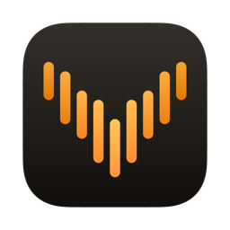
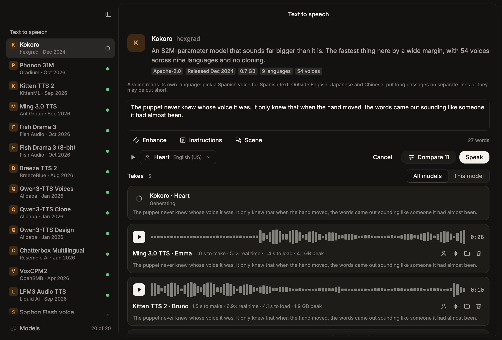
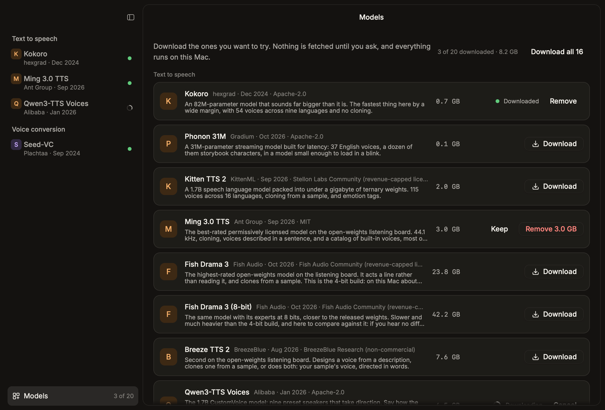
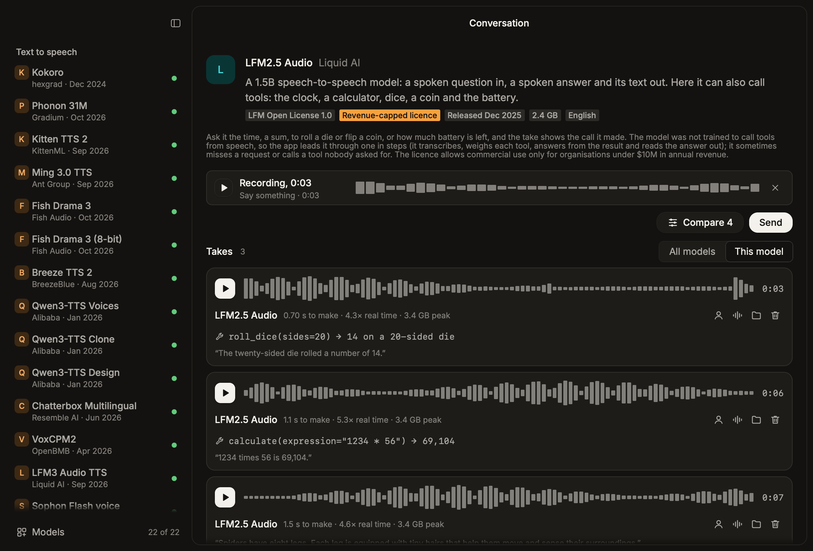
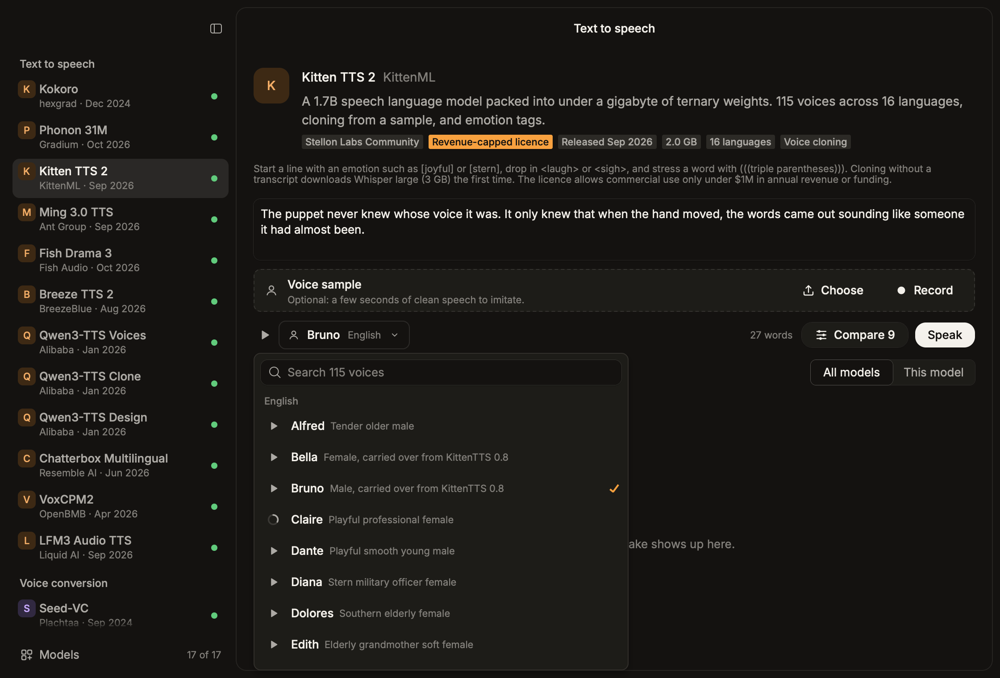
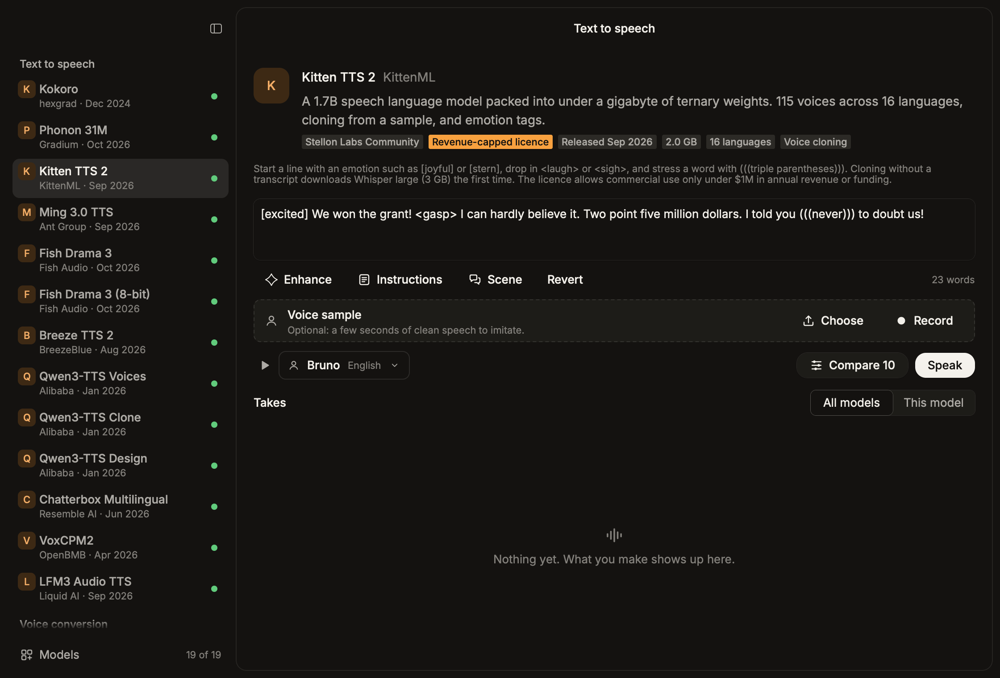
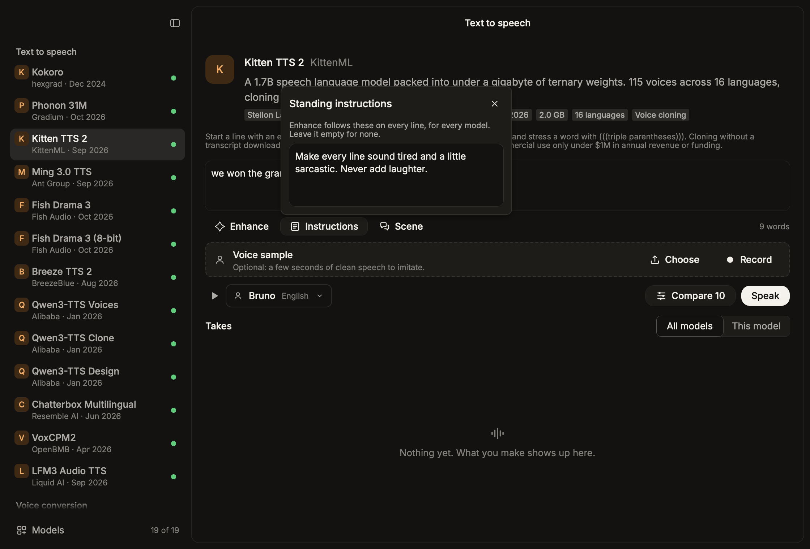
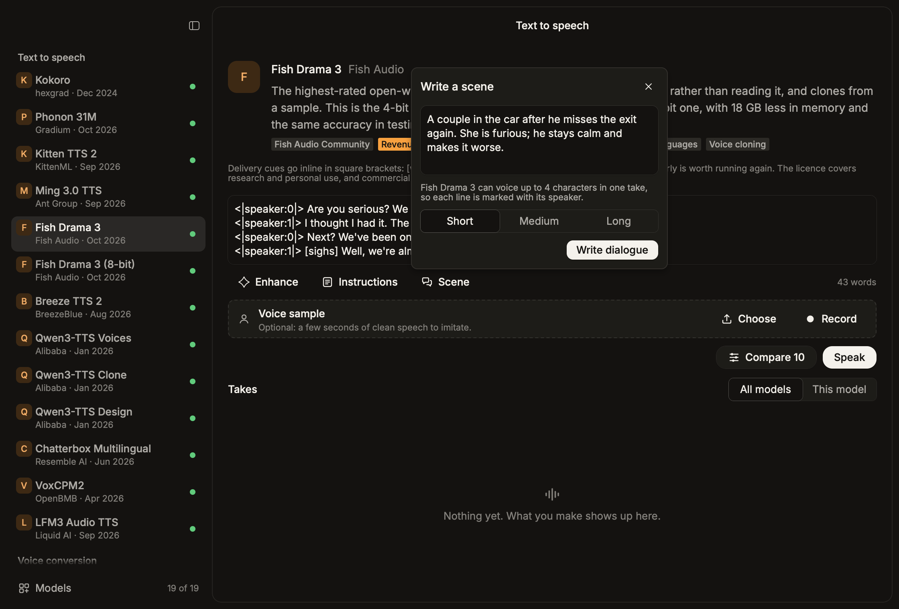

# Ventriloquist

A native macOS bench for speech models that run on this Mac. Type a line or record a clip,
pick a model, and compare what comes out and how long it took.

The window is [Rune](https://github.com/anomalyco/rune) (Rust, GPU-rendered, no web view).
The models run in Python workers the app starts on demand and keeps warm, so the second run
of a model measures the model and not its start-up.



## Install

Download `Ventriloquist.dmg` from the [website](https://nearbycoder.github.io/Ventriloquist/)
or the [latest release](https://github.com/nearbycoder/Ventriloquist/releases/latest), open
it and drag the app to Applications. It needs an Apple silicon Mac, and
[`uv`](https://docs.astral.sh/uv/) (`brew install uv`) to install models. Nothing else: no
ffmpeg, no system Python packages.

A released copy keeps itself up to date: it checks for a new version once a day, shows the
release notes and installs it when you agree. **Ventriloquist › Check for Updates** asks at
once.

## Build

```sh
scripts/bundle --install --open     # builds Ventriloquist.app and puts it in /Applications
cargo run --release                 # or run it straight from the checkout
```

Building needs Rust (`rustup`) and, for the app icon, Xcode. A build made this way has no
updater; it is replaced by building again.

## The first run

Nothing is downloaded until you ask. A new install opens on the **Models** page (the row at
the foot of the sidebar), which lists every model with its size and release date. Download
the ones you want; the sidebar then shows only those. **Remove** deletes a model's weights
again, and its Python environment once no other model needs it.



The same from a terminal:

```sh
scripts/setup-models --list
scripts/setup-models kokoro ming
scripts/setup-models --remove ming
scripts/setup-models --all          # about 130 GB, environments included
```

## The models

Chosen in November 2026 for an M5 Max with 128 GB: open weights, no Hugging Face gate, and a
real path on Apple Silicon (MLX, or PyTorch on Metal). Each was installed and run here, and
its output transcribed back to check the words. Times are for the same eight-second line once
the model is loaded. Released is when the weights were first published.

**Text to speech** (through [mlx-audio](https://github.com/Blaizzy/mlx-audio), except Kitten, which has its own package, and ZONOS3, which runs on Zyphra's MLX runtime)

| Model | Released | Licence | Size | What it does | 8 s of speech in |
|---|---|---|---|---|---|
| Kokoro 82M | Dec 2024 | Apache-2.0 | 0.7 GB | 54 voices in 9 languages, no cloning | 0.17 s |
| Phonon 31M | Oct 2026 | Apache-2.0 | 0.1 GB | 37 English voices, built for latency | 0.22 s |
| ZONOS3 Mini | Nov 2026 | Apache-2.0 | 2.9 GB | 27 voices in 10 languages (43 spoken), cloning, steering by named controls, 44.1 kHz | 0.7 s |
| Kitten TTS 2 1.7B | Sep 2026 | Stellon Labs Community (revenue cap) | 2.0 GB | 115 voices in 16 languages, cloning, emotion tags | 1.5 s |
| Ming 3.0 TTS 0.5B | Sep 2026 | MIT | 3.0 GB | 243 voices, cloning, described voices, 44.1 kHz | 1.6 s |
| Fish Drama 3 | Oct 2026 | Fish Audio Community (revenue cap) | 23.8 GB | acts the line, cloning, inline cues (4-bit build) | 2.7 s |
| Fish Drama 3 (8-bit) | Oct 2026 | Fish Audio Community (revenue cap) | 42.2 GB | the same model, heavier; kept to compare | 3.7 s |
| Breeze TTS 2 | Aug 2026 | BreezeBlue Research (non-commercial) | 7.6 GB | described voices, cloning, directed cloning | 4.7 s |
| Qwen3-TTS 1.7B Voices | Jan 2026 | Apache-2.0 | 4.5 GB | 9 speakers that take direction | 2.5 s |
| Qwen3-TTS 1.7B Clone | Jan 2026 | Apache-2.0 | 4.5 GB | speaks in a sampled voice | 2.3 s |
| Qwen3-TTS 1.7B Design | Jan 2026 | Apache-2.0 | 4.5 GB | invents a voice from a description | 2.8 s |
| Chatterbox Multilingual v3 | Jun 2026 | MIT | 3.2 GB | cloning in 23 languages | 2.0 s |
| VoxCPM2 2B | Apr 2026 | Apache-2.0 | 5.0 GB | cloning or described voices, 48 kHz | 1.7 s |
| LFM3 Audio TTS 2B | Sep 2026 | LFM Open 1.0 (revenue cap) | 2.5 GB | a female and a male voice | 0.9 s |
| Sophon Flash voice | Nov 2026 | Apache-2.0 | 4.5 GB | the voice stage of Sophon Realtime (below) on its own: two voices, sound tags, cloning | 1.9 s |

**Voice conversion** (a recording in, the same words in another voice out; PyTorch on Metal)

| Model | Released | Licence | Size | What it does | 8 s converted in |
|---|---|---|---|---|---|
| Seed-VC | Sep 2024 | GPL-3.0 | 4.5 GB | diffusion; keeps the performance best | 1.4 s |
| Chatterbox VC | Apr 2025 | MIT | 1.1 GB | watermarked output | 1.1 s |
| OpenVoice v2 | Apr 2024 | MIT | 0.3 GB | moves timbre only, nearly instant | 0.08 s |

**Conversation** (a spoken question in, a spoken answer out; MLX)

| Model | Released | Licence | Size | What it does | Answers in |
|---|---|---|---|---|---|
| Sophon Realtime 32B Flash | Nov 2026 | Apache-2.0 | 22.6 GB | hears tone as well as words, answers with laughs and sighs, two voices, English and Chinese; ported here | about 5 s |
| Nemotron VoiceChat 11B | Jul 2026 | OpenMDW-1.1 | 13.9 GB | one full-duplex model, no ASR or TTS step | about 13 s |
| LFM3 Audio 2B | Sep 2026 | LFM Open 1.0 (revenue cap) | 2.5 GB | turn-based, answer plus its text | about 2 s |
| LFM2.5 Audio 1.5B | Dec 2025 | LFM Open 1.0 (revenue cap) | 2.4 GB | turn-based, and calls tools: clock, calculator, dice, coin, battery | 1 to 5 s |

Sophon-Realtime-32B-Flash is published for vLLM-Omni on NVIDIA GPUs and had no Apple Silicon
runtime, so the one here is a port written for this app (`sidecar/sophon.py`), from the
published weights and the project's Apache-2.0 serving code:

- its language model, a 32B Qwen3 whose layers ship as FP8, is converted once at install to a
  4-bit MLX model (18 GB) that mlx-lm runs; the 33 GB original is deleted afterwards;
- its audio encoder and projector run in PyTorch as published, and their output stands in
  the prompt where the speech goes, so the model hears the recording and not a transcript;
- its reply, with sound tags such as `[laughter]`, is spoken by its own voice stage, a
  Qwen3-TTS fine-tune that mlx-audio loads as it is.

The encoder was checked against the reference implementation on the same audio (identical
output), and the whole path by asking it spoken questions in English and Chinese. What is not
ported is the live session around the model: listening while it speaks, being interrupted,
deciding when you have finished. Nor are tool calling and the camera. One recording goes in
and one reply comes out.

ZONOS3 Mini runs on the MLX runtime from Zyphra's own repository, checked out at a fixed
commit and installed from its lockfile. Its direction field takes the controls the model
ships with, by name and optional amount: `happy`, `whisper 1`, `slower 2`, `british accent`,
`deep 3`, or a preset such as `Late-night radio`. A voice sample is turned into a speaker
embedding by the model's own encoder. Its text normaliser needs a library with no macOS
build, so numbers and dates are read as written.

LFM2.5 Audio is the one that calls tools. Ask it the time, a sum, for a die or a coin, or
how much battery is left, and the take shows the call beside the answer. The published model
has a place for tools in its prompt but was not trained to call them from speech: shown a
list it mostly declines, and when pushed it picks whichever tool comes first. What it can do
is weigh one tool at a time against a question it has as text. So `worker.py` leads it
through a call in steps, each of them the same model: it transcribes the recording; each
tool is offered alone and the model's own probability of opening a call is read off; it
writes the arguments for the likeliest, the tool runs, and it answers from the result; then
it reads that answer out in its text-to-speech mode. With no tool wanted it answers the
recording directly. On 34 test recordings it called the right tool for all 18 requests and
called one unasked in 1 of 16 ordinary questions ("how are you doing today?" got the time).
The tools are in `sidecar/tools.py`; they run locally and change nothing.



Four of these carry licences to read before using them for work, and the app marks them:
Breeze TTS 2 is research and non-commercial only, and Fish Drama 3, Kitten TTS 2, LFM3 and
LFM2.5 allow commercial use only below a revenue threshold. Left out: Higgs Audio v3, Voxtral TTS and
F5-TTS (also non-commercial), Sesame CSM, Orpheus and NeuTTS (gated), PersonaPlex and
Unmute (CUDA only), RVC (needs a model trained per voice), and Moshi (superseded, and its
MLX port has no file-in, file-out path).

## Using it

- **Speak** runs the selected model; **Compare** runs every installed model of that kind on
  the same input, one at a time so the timings are fair. Return runs (Shift-Return for a
  new line), ⌘. cancels.
- Models with voices of their own have a **voice button**: it opens the full list, with a
  search field once the list is long. The play button on each voice reads a short line in
  it, in the voice's own language; the first listen has the model make it, and after that
  it plays from disk. Sophon Realtime answers in the voice chosen (a Chinese voice answers
  in Chinese); the other conversation models have one voice each, so they have no list.

  

- **Enhance** has a small language model on this Mac (Gemma 4 E4B, the one Figment uses,
  through mlx-lm) mark the line up for the selected voice model. It punctuates for delivery,
  spells out numbers and dates, and adds the expression marks that model understands and no
  others: `[joyful]`, `<sigh>` and `(((stress)))` for Kitten, `[sighs]`-style cues for Fish
  Drama 3, `(laugh)` for Breeze, Ming's tag set, and nothing but punctuation for models
  without tags. For a model with a direction field it fills that in too, when it is empty.
  **Revert** puts your line back. The note button beside Enhance holds **standing
  instructions** that it follows on every line ("make everything sound tired and sarcastic",
  "add hesitations", "translate into Spanish"); they are kept between launches. It is a download of its own on the Models page, under
  Helpers; removing it there leaves the weights for other apps.

  

  

- **Scene** writes dialogue from a description of a scene: who is talking, where, what
  happens. Pick short, medium or long. For Fish Drama 3, which voices up to four characters
  in one take, each line is marked with its speaker (`<|speaker:0|>`, `<|speaker:1|>`) and
  carries its cues; a model with one voice gets one character's lines. Standing instructions
  apply here too, and Revert brings back the text that was there.

  

- The window reopens where it was closed: the text, the clips in the slots, the voices
  chosen and the model on the bench.

- Enhance and Scene refuse to write sexual content involving minors, whatever the standing
  instructions say; the request and the result are both checked.
- A **voice sample** or **speech** slot takes a dropped file, a chosen file or a recording.
  Anything that isn't a plain WAV is converted with `afconvert` first.
- Each take shows its waveform (click to seek), how long it took, its speed against real
  time, load time when it had to load, and peak memory. The icons on a take hand it to the
  next run as the voice sample or as the speech to convert.
- Engines stay loaded between runs. **Unload** in the toolbar quits them and frees the memory
  (Fish Drama 3 holds about 30 GB, its 8-bit build about 49 GB, Sophon Realtime about 28 GB).

## How it fits together

```
src/            the app: state.rs (everything that changes), view/ (what it looks like),
                engine.rs (worker and installer processes), catalog.rs, wav.rs, scenes.rs
sidecar/
  catalog.json  every model: what the app shows, how the worker calls it, what to download
  worker.py     one long-lived process per Python environment; JSON lines on stdin/stdout
  sophon.py     the Sophon Realtime port: weight conversion, audio encoder, prompt and reply
  tools.py      what a conversation model may call: clock, calculator, dice, coin, battery
  setup.py      builds environments with uv and downloads weights (standard library only)
scripts/        bundle, dmg, release, sparkle (the app, its installer, a release, the updater);
                setup-models, try-model, refresh-voices (rebuilds the voice lists)
docs/           the website and the update feed, served by GitHub Pages
```

The sidecar files are compiled into the binary and written to
`~/Library/Application Support/Ventriloquist/sidecar` at launch, so the app is one file.
Environments, recordings, takes and history live beside them; weights go to the shared
Hugging Face cache (`~/.cache/huggingface`), except Seed-VC's, which sit in its environment.

There are six environments, because the libraries don't agree on versions: `mlx`
(Python 3.12, mlx-audio 0.6.5), `kitten` (3.12, KittenML's own package on its MLX backend),
`zonos` (3.12, Zyphra's repository at a fixed commit, installed from its lockfile),
`chatterbox` (3.11, torch 2.6), `seedvc` (3.10, torch 2.6 with Seed-VC checked out at a
fixed commit) and `coqui` (3.12, torch 2.8).

To add a model that mlx-audio supports, add an entry to `sidecar/catalog.json`; the
`mlx_tts` and `mlx_sts` adapters in `worker.py` call anything with the standard `generate`.
Then try it without the window:

```sh
scripts/try-model ming "Good evening." --voice UK_Charlotte --twice
scripts/try-model seed-vc --source speech.wav --ref voice.wav
scripts/try-model lfm25-audio --source question.wav
scripts/try-model zonos3 "Stay with us." --instruct "Late-night radio"
scripts/try-model kitten "we won the grant i can hardly believe it" --enhance
scripts/try-model drama3 "two friends argue about who left the door open" --scene short
```

## Working on it

```sh
cargo test                          # state, catalog and window tests; no models needed
cargo test -- --ignored             # drives the real worker (needs Kokoro installed)
cargo run -- --snap out.png --scene takes [--theme light]
cargo run -- --list-scenes
```

Every scene renders headless with the same renderer as the window, which is how the
screenshots here, the app icon and the installer's background are made.

## Releasing

```sh
scripts/release                     # builds, signs, notarizes, publishes and updates the feed
```

Set the new version in `Cargo.toml`, describe it under a `## <version>` heading in
`CHANGELOG.md`, commit, and run it. The script:

1. builds the app with the updater in it and signs it with the Developer ID certificate in
   the keychain, under the hardened runtime;
2. has Apple notarize the app, then builds the installer (`scripts/dmg`), signs it and has
   that notarized too;
3. signs the update with the feed's key and adds the version, with its release notes, to
   `docs/appcast.xml`;
4. tags the commit, publishes `Ventriloquist.dmg` and the update archive as a GitHub release,
   and pushes, which publishes the feed.

Installed copies read the feed from GitHub Pages
(`https://nearbycoder.github.io/Ventriloquist/appcast.xml`) and take an update only if it
carries a valid signature from the feed's key. The updater is
[Sparkle](https://sparkle-project.org), downloaded at build time by `scripts/sparkle` and
not kept in the repository. What a Mac needs before it can cut a release is listed at the
top of `scripts/release`.

The website is `docs/`, served by GitHub Pages from `main`. Its model table reads
`docs/catalog.json`, a copy of `sidecar/catalog.json` that the release script refreshes.

No model weights are in the repository or in the app: every model is downloaded from its
publisher when the user asks for it.

## Things to know

- A build from `scripts/bundle` is signed ad hoc, so macOS asks for the microphone again
  after each rebuild. Set `SIGN_IDENTITY` when running it to keep the answer. Released
  copies are signed with a Developer ID and keep it across updates.
- Everything runs locally, but the libraries may still contact Hugging Face when a model
  loads, to check for a newer revision.
- Chatterbox VC watermarks its output. Seed-VC is GPL and its project is archived.
- Nemotron VoiceChat answers on the recording's own clock, so each run decodes 20 seconds
  past the end of the clip to give it room to finish.
- Removing a model deletes its repositories from the shared Hugging Face cache, so another
  tool that used the same repository would fetch it again.
- Uninstalling: remove the models from the Models page, then delete the app and
  `~/Library/Application Support/Ventriloquist`.
